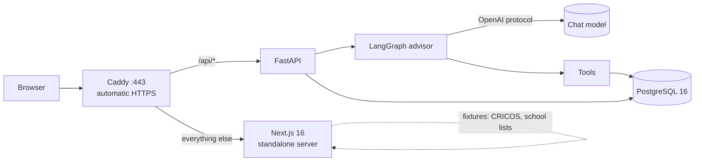

# LeapAshore 鱼跃彼岸

**An application-planning agent for master's degrees at the world's top universities.**
留学申请 agent：覆盖 29 个国家和地区的 287 所大学（以 QS 2027 前 300 为主），把申请拆成一张能点开的路线图，每条要求都能追溯到官方页面。

**Live demo:** <https://leapashore.mortyyjt.site>

| Entry | What to try |
| --- | --- |
| [`/assess`](https://leapashore.mortyyjt.site/assess) | One-page background assessment, saved to the server |
| [`/assess/result`](https://leapashore.mortyyjt.site/assess/result) | Every program with a stated requirement in your field, tiered 保底 / 稳妥 / 冲刺 / 不满足, with what to check on the official page |
| [`/roadmap`](https://leapashore.mortyyjt.site/roadmap) | The timeline from today to the intake: suggested dates dashed, unrecorded deadlines hollow |
| [`/schools`](https://leapashore.mortyyjt.site/schools) | 287 schools by QS rank, with how many programs each has collected |
| [`/programs`](https://leapashore.mortyyjt.site/programs) | Search the collected programs; each cites its official page |
| [`/advisor`](https://leapashore.mortyyjt.site/advisor) | Chat with the LangGraph advisor agent |

Things to ask the advisor:

- `悉尼大学计算机硕士要什么均分和雅思？` — retrieval, evidence gate, numbered citations to the official page
- `乌得勒支大学数据科学硕士要什么条件？` — the gate refuses: that school is not collected yet
- `我是武汉大学计算机专业，均分 85，雅思 7.0` — the agent writes the profile (low-risk write, runs at once)
- `把蒙纳士人工智能硕士加进我的选校组合，作为冲刺` — the agent proposes the change and waits for a confirm click

## Why this exists

Applicants plan a master's application over 6–12 months from facts scattered across dozens of
university pages. Agencies are opaque, spreadsheets go stale, and general chatbots invent admission
requirements that an applicant will then act on.

LeapAshore's position: **every factual claim traces to an official page, and when the system cannot
source an answer it says so instead of guessing.** The full product requirements are in
[docs/product/PRD.md](docs/product/PRD.md) (Chinese).

## Architecture



- One origin: Caddy routes `/api/*` to FastAPI and the rest to Next.js, so the anonymous
  `leapashore_client` cookie is same-origin and needs no CORS plumbing.
- The advisor streams over server-sent events; Caddy flushes immediately so tokens arrive as they are
  produced.
- Everything runs from one `docker compose` file on a 2-core, 4 GB server
  ([deploy/compose.prod.yaml](deploy/compose.prod.yaml)).

## The advisor agent


Code: [api/app/agent/](api/app/agent/).

| Decision | Why |
| --- | --- |
| **Intent = which state the message wants to change**, not keywords | An application only changes in five ways (plan, verify a requirement, add background, operate on tasks, general Q&A), so routing on the state touched is exhaustive and explainable |
| **Evidence gate before generation** | A requirement answer needs a catalogue hit, an https source with a title and id, and a relevance score above the threshold. Otherwise the agent refuses and logs a knowledge gap. Unverified sources are shown but labelled 待核验 with the link |
| **Two write levels** | Profile updates are idempotent and run at once. Portfolio changes can overwrite the applicant's choices, so the tool calls `interrupt()` and writes only after a confirm click resumes the graph |
| **Step cap, not token cap** | One step is one model call: countable and explainable. A token cap that misfires cuts the chain after the model has already decided to call a tool |
| **Identity from config, never from the model** | Tools read the client id from the run config, so no prompt can make the agent read or write another applicant's rows |
| **Router failure degrades to general Q&A** | The one exit that writes nothing |

## Data and honesty rules

| Data | Source | State |
| --- | --- | --- |
| Australian master's programs (2,920) | CRICOS, data.gov.au, CC BY 2.5 AU | Real, attributed, dated |
| Chinese institutions (3,167) and tier tags | Public lists | Real; known gaps recorded in the fixture |
| Overseas schools (287) | QS World University Rankings 2027 top 300 in the 29 countries and regions in scope (241) + 46 for regional coverage | Real |
| Admission requirements (5,223 programs at 120 schools) | Official course pages, each quote checked against a saved snapshot | **Machine-checked (机器核对)** for 5,163; the other 60 have no value that passed the check and are not imported. None human-verified yet. In the site's catalogue, 5,159 of the 5,163 state a requirement the program page shows (English, a mark, a prerequisite, an academic requirement or a deadline; 4,831 carry an academic requirement); the other 4 have only English notes without a score, which are not stored. The catalogue's 「有要求」 count is 5,161: those 5,159 plus 2 hand-entered 待核验 placeholders (local import, 2026-10-30) |
| Deadlines | Official pages, each quote checked against a saved snapshot | **Imported, machine-checked**: 3,986 dates for 2,335 programs at 79 schools (2026-10-30). Each is shown with its source page; one before today's Beijing date is labelled 已截止 (130 on 2026-10-30) and never drawn as a future date. A date entered on a portfolio row is never overwritten by the import |

These rules exist because an earlier version of this product generated a plausible verification
date and an official-looking threshold with no source. Do not undo them.

1. Every requirement carries a verification state: 待核验 / 机器核对 / 人工已核验.
2. `verified_at` is written by a human, never defaulted.
3. Unknown stays unknown — never an empty string, never a zero.
4. Suggested dates are labelled as system suggestions; an official deadline without a source renders as 未收录, and a past one as 已截止.
5. Tiers describe how far a background meets the published requirements, not admission odds.

## Tech stack

| Layer | Choice |
| --- | --- |
| Frontend | Next.js 16, React 19, TypeScript, Tailwind CSS 4 |
| Backend | FastAPI, SQLAlchemy 2, Alembic, PostgreSQL 16 |
| Agent | LangGraph 1.2, LangChain OpenAI adapter, any OpenAI-compatible model |
| Deploy | Docker Compose, Caddy |

## Run it

Locally:

```bash
make install     # frontend and backend dependencies
make dev         # database, API on :8000, frontend on :3000
make test        # type-check, frontend unit tests, backend tests
```

Set `CHAT_API_KEY` (and optionally `CHAT_BASE_URL`, `CHAT_MODEL`) in `api/.env` to enable the advisor.
Without a key the rest of the app works and the advisor says it is not configured.

On a server:

```bash
cp deploy/.env.example deploy/.env   # set POSTGRES_PASSWORD and CHAT_API_KEY
docker compose -f deploy/compose.prod.yaml up -d --build
```

The API container applies migrations and runs the idempotent seeds on start.

## Status

Done:

- Onboarding, portfolio picker, six-phase roadmap with material checklists
- School and program libraries, background assessment with rule-by-rule tiers
- Material library: upload, versions, archive, download (size limit, type sniffed from bytes)
- Advisor agent: intent routing, evidence gate, ReAct tools, confirm-before-write, streamed replies
- Production deployment over HTTPS
- Requirement collection: snapshot each official page, check every quote against it, import only what passed

Not yet:

- Requirements are collected for 133 of the 287 schools (13 of those blocked or unreachable); the rest
  show 待采集 (to be collected). Requirements published only in PDFs are not read yet
- No requirement has been verified by a person (`verified_at` is empty everywhere)
- Conversations live in an in-memory checkpointer and are lost on restart (a Postgres checkpointer is
  a schema change and needs its own migration)
- Knowledge gaps go to the log, not to a review queue
- The router and gate evaluation set (`api/evals/`, 80 questions: 50 tuning, 30 held out) is
  labelled by AI, not by a person
- Email-code accounts are built but switched off in production until outgoing mail is set up; the live
  site still ties the profile to an anonymous cookie

## Project records

- [Product requirements (Chinese)](docs/product/PRD.md)
- [Task list (Chinese)](TASKS.md)
- [Repository rules for the coding agent](CLAUDE.md)
- [Cross-change decisions (Chinese)](note/decisions.md)
- [Backend design (Chinese)](note/design/)

## License

The code is under the [MIT License](LICENSE). Collected data keeps its sources' terms: CRICOS data is
CC BY 2.5 AU, QS rankings are QS's, and quotes belong to the schools that published them.
