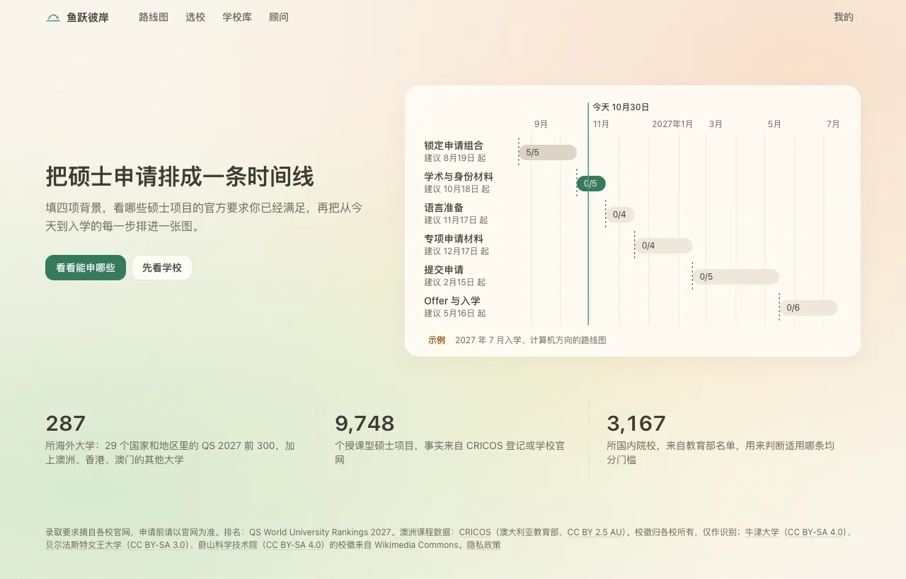
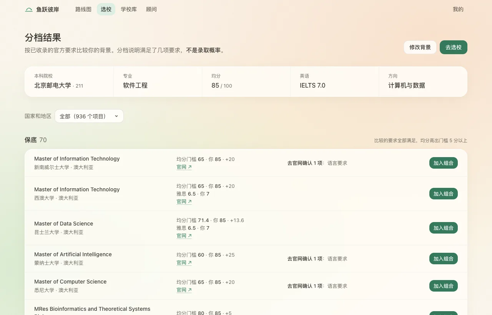
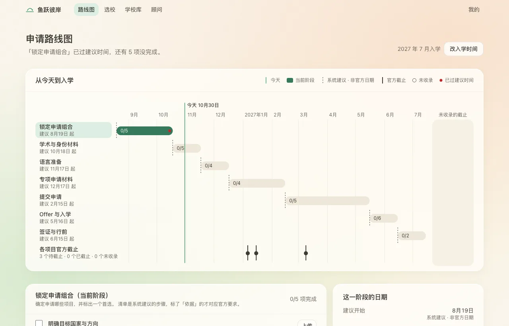
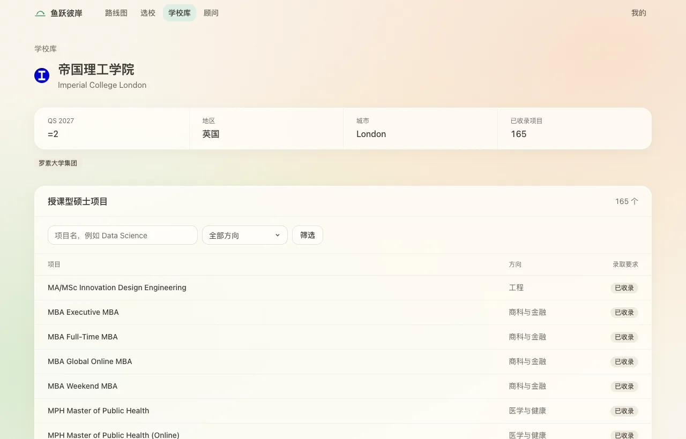
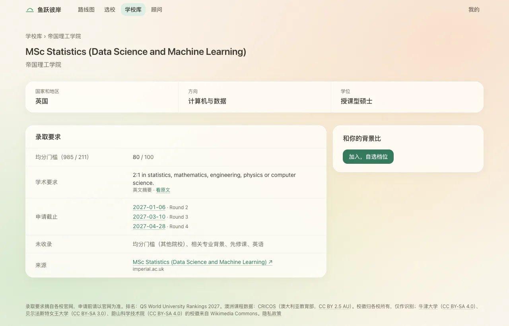
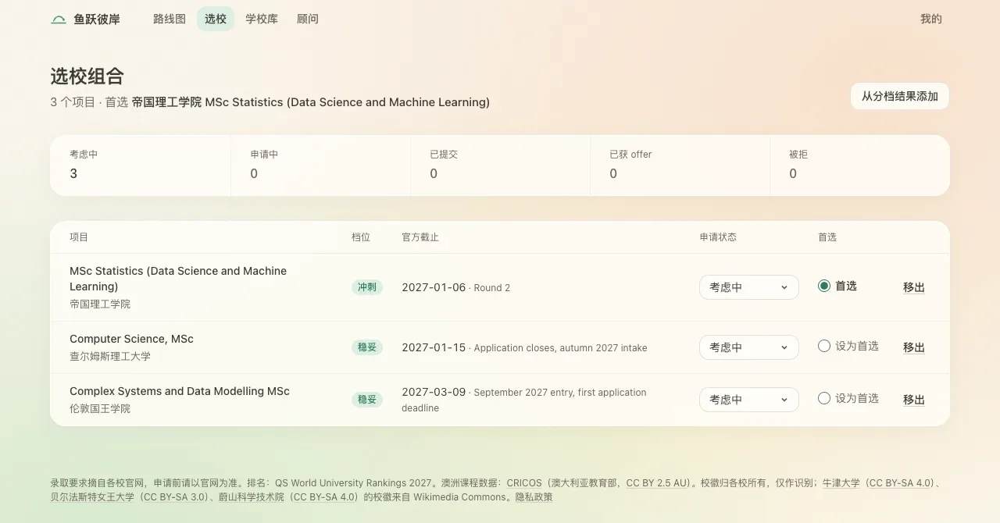
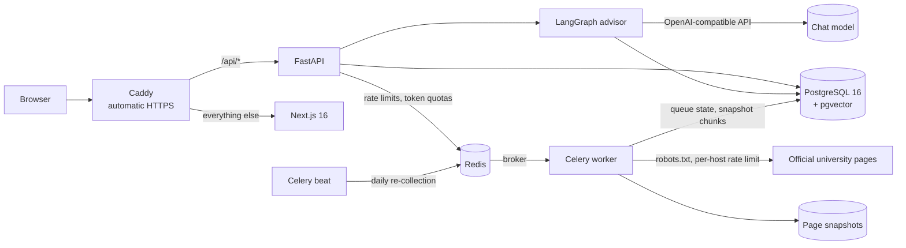
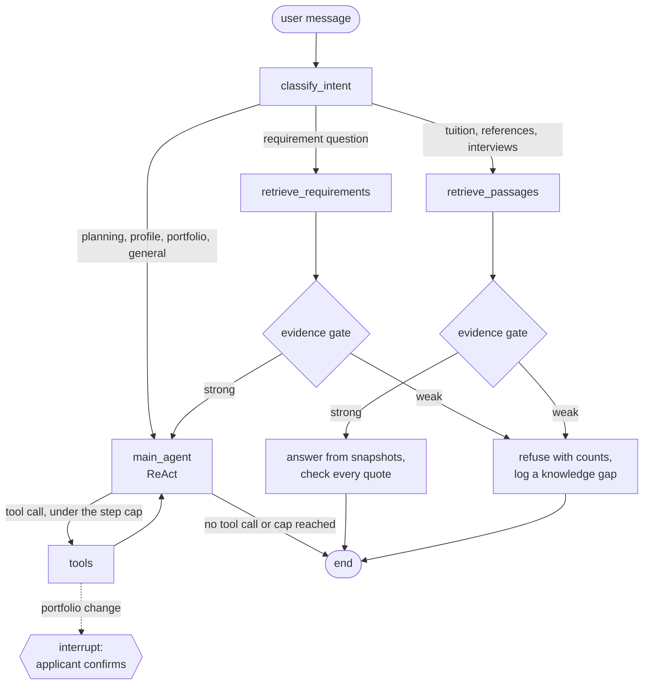

# LeapAshore

**An application-planning agent for taught master's degrees at the world's top universities, where every requirement traces to an official page.**

[](https://github.com/MortyYJT/LeapAshore/actions/workflows/ci.yml)
[](LICENSE)
[](https://leapashore.mortyyjt.site)



**Live site:** <https://leapashore.mortyyjt.site> (the interface is in Chinese; it is built for applicants from mainland China).

Applicants plan a master's application over 6 to 12 months from facts scattered across dozens of university pages. Agencies are opaque, spreadsheets go stale, and general chatbots invent admission requirements that applicants then act on. LeapAshore collects the requirements from the official pages themselves, checks every quote against a saved snapshot of the page, and refuses to answer when it has no source.

## Contents

- [What it does](#what-it-does)
- [How it works](#how-it-works)
- [Engineering highlights](#engineering-highlights)
- [Data and coverage](#data-and-coverage)
- [Tech stack](#tech-stack)
- [Running locally](#running-locally)
- [Evaluation](#evaluation)
- [Status and limitations](#status-and-limitations)
- [Repository layout](#repository-layout)
- [Documentation](#documentation)
- [License](#license)

## What it does

- **School library.** 287 universities in 29 countries and regions, ordered by QS 2027 rank. Each school page lists its collected taught master's programs, filterable by name and study area; each program page shows only the requirements that were found (mark thresholds, English, academic background, deadlines), each linked to the official page it came from.
- **Requirement tiers.** An applicant enters four facts (undergraduate school, average mark, English score, target field). Every program with a stated requirement in that field is placed in a tier by how many published requirements the background meets, with the items still to confirm on the official page. Tiers describe requirements met, not admission odds.
- **Portfolio.** The chosen programs with a tier, an application status, the official deadline and one first choice.
- **Application roadmap.** A timeline from today to the intake, with phases, material checklists and file uploads. Suggested dates are drawn as system suggestions; official deadlines appear only when collected from an official page, and a past one is labelled as closed instead of being drawn as a future date.
- **Cited advisor agent.** A LangGraph agent that answers requirement questions from the catalogue, and questions about tuition, references and interviews from saved page snapshots, citing the official page. It refuses when the evidence is weak, can update the applicant's profile, and proposes portfolio changes that are written only after the applicant confirms them.

| Requirement tiers | Application roadmap |
| --- | --- |
|  |  |

| School page | Program page | Portfolio |
| --- | --- | --- |
|  |  |  |

The tiers, portfolio and roadmap screenshots come from a local build with a made-up profile.

## How it works



- **One origin.** Caddy sends `/api/*` to FastAPI and everything else to Next.js, so the session cookie is same-origin and needs no CORS. Advisor replies stream over server-sent events and Caddy flushes them immediately.
- **One compose file.** Production runs PostgreSQL, Redis, the API, the Celery worker and beat, Next.js and Caddy from [deploy/compose.prod.yaml](deploy/compose.prod.yaml).
- **The catalogue is written only by the importer.** Collection writes JSON files per school ([api/data/requirements/](api/data/requirements/)); the importer loads a value only if its quote passed the snapshot check and the model judge did not find its summary unfaithful.

### The advisor agent



Code: [api/app/agent/](api/app/agent/). Design choices:

| Decision | Why |
| --- | --- |
| **Route on the state a message wants to change**, not on keywords | An application changes in five ways (plan, verify a requirement, add background, operate on the portfolio, general questions), so routing on the state touched is exhaustive and explainable |
| **Evidence gate before generation** | A requirement answer needs a recognised school, a program that states a requirement, an https source with a title, and a matching subject when one is named. Otherwise the agent refuses, says what the library does hold, and records a knowledge gap. Every cited source is linked so the applicant can check the official page |
| **Two write levels** | Profile updates are idempotent and run at once. Portfolio changes can overwrite the applicant's choices, so the tool calls `interrupt()` and writes only after a confirm click resumes the graph |
| **Step cap, not a token cap** | One step is one model call: countable and explainable. A token cap that misfires cuts the chain after the model has already decided to call a tool |
| **Identity from the run config, never from the model** | Tools read the applicant's id from the config, so no prompt can make the agent read or write another applicant's rows |
| **Model failures end the turn cleanly** | When the provider refuses a call (out of credit, rate-limited, unreachable), the advisor says it is temporarily unavailable, keeps any change already confirmed, and records nothing as a knowledge gap |

## Engineering highlights

Every number below is copied from [docs/measurements.md](docs/measurements.md), which also has the commands, dates and caveats.

- **Advisor retrieval, measured before it was changed.** On a 30-question held-out set, Recall@4 went from **0.10 to 0.889** (Precision@4 0.933, false pass 0/6, false block 0/15, down from 0.60), run once on the final code and not tuned on afterwards. On the tuning split each question now reads about 173 rows in 5 ms instead of about 11,100 rows in 144 ms. Full-text ranking later raised held-out Recall@4 from 0.8958 to 0.9583 on the grown catalogue; the gain is a single question, and the record explains why it should be discounted. The evaluation labels were written by an AI against the local database, not reviewed by a person. ([retrieval](docs/measurements.md#fix-advisor-retrieval-baseline-first-then-change-pr-38), [full-text ranking](docs/measurements.md#hybrid-retrieval-pr-58-vector-part-waiting-for-the-owners-siliconflow-key))
- **Answers from page snapshots, checked sentence by sentence.** Each sentence must carry a verbatim quote of 12 or more characters found in a stored chunk, and every number in the sentence must appear in its quotes; otherwise the sentence is removed before anything is sent. In one live run over 38 questions, **82/82 quotes passed the check and 6/6 unanswerable questions were refused**. ([snapshot RAG](docs/measurements.md#snapshot-rag-pr-60))
- **A model judge for summaries.** Every extracted value's summary is judged against its quote before import. On 490 sampled fields (100 random, 390 stratified by field) labelled blind to the judge, it caught **70.1%** of unfaithful summaries (103/147) and wrongly blocked **7.9%** of faithful ones (27/343), precision 79.2% (103/130); weighted to the whole collection, 69.3% caught and 5.7% wrongly blocked. It misses most deadline labels that add an intake. Labels are an AI's, not reviewed by a person. ([faithfulness](docs/measurements.md#summary-faithfulness-evaluation-second-set-pr-83))
- **Conversations survive a crash, and confirmed writes happen once.** Conversations are LangGraph checkpoints in PostgreSQL. A process killed with `SIGKILL` while waiting for a confirmation is resumed by a second process that writes exactly once; a third sees nothing pending and writes nothing, and two simultaneous confirmations also write once. ([persistence](docs/measurements.md#conversation-persistence-pr-56))
- **Rate limits and token quotas in Redis.** Sliding windows per applicant and per IP plus daily token quotas, checked atomically in one Lua script; each turn reserves tokens up front and settles them against the usage the model reports. The limit check measured **p99 5.61 ms** at concurrency 50 over 20,000 checks; a forged `X-Forwarded-For` header had no effect behind Caddy; if Redis is unreachable the advisor fails closed with 503. ([limits](docs/measurements.md#advisor-rate-limits-and-quotas-pr-40-follow-up-pr-44))
- **A polite collection queue.** One Celery task per page with a per-host token bucket (2 s, or the site's robots.txt `Crawl-delay`); robots.txt refusals, 403s and 429s are recorded and never bypassed or retried; an unchanged page costs no model call. The first large run collected 3,628 of 3,833 pages for at most 36.37 yuan of model cost. ([collection queue](docs/measurements.md#collection-queue-and-change-detection-pr-50-queue-code-pr-51-data-pr-52-review-pr-54-second-round))
- **Only a person can mark a source verified.** A database trigger refuses any non-empty `verified_at` unless an admin's confirmation row is written in the same transaction, and a static scan of the code fails the tests when a new writer of that column appears. ([manual verification](docs/measurements.md#manual-verification-entry-pr-69))

## Data and coverage

| Data | Source | Coverage |
| --- | --- | --- |
| Universities | QS World University Rankings 2027 | 287 schools in 29 countries and regions: the 241 schools of the top 300 inside the covered regions, plus 46 added for regional coverage ([PRD](docs/product/PRD.md#1-positioning)) |
| Australian programs | [CRICOS](https://data.gov.au/data/dataset/cricos), Australian Government Department of Education, [CC BY 2.5 AU](https://creativecommons.org/licenses/by/2.5/au/) | 2,920 master's programs ([measurements](docs/measurements.md#unify-the-requirement-count-and-check-production-pr-46)) |
| Programs and admission requirements elsewhere | Each school's official program pages, collected from saved snapshots | 9,035 programs at 250 schools in the collection files ([PRD](docs/product/PRD.md#8-data-sources)); 9,748 programs in the production catalogue ([measurements](docs/measurements.md#collection-queue-and-change-detection-pr-50-queue-code-pr-51-data-pr-52-review-pr-54-second-round)), of which 7,374 state a requirement and 4,115 passed every machine check ([measurements](docs/measurements.md#summary-faithfulness-check-pr-62)) |
| Application deadlines | Official program pages, checked the same way | 3,555 deadlines for 1,947 programs at 111 schools ([PRD](docs/product/PRD.md#8-data-sources)) |
| Page snapshots for the advisor | The same official pages | 9,344 pages split into 132,204 chunks in production ([measurements](docs/measurements.md#snapshot-rag-pr-60)) |
| Chinese undergraduate institutions | Ministry of Education list of higher-education institutions (as of 2025-06-20) | 3,167 institutions, used to decide which mark threshold applies |

Honesty rules the code enforces:

1. Every requirement carries a verification state: unverified, machine-checked, or verified by a person.
2. `verified_at` is written only by a person's confirmation, never by a default, an importer or a job.
3. Unknown stays unknown: never an empty string, never a zero.
4. Suggested dates are labelled as suggestions; an official deadline without a source is shown as not collected, and a past one as closed.
5. Tiers describe how far a background meets the published requirements, not admission odds.

Licences and attribution: CRICOS data is used under CC BY 2.5 AU. QS rankings belong to QS Quacquarelli Symonds, and QS's terms restrict republication. Requirement quotes belong to the schools that published them; the site shows them as excerpts with links and asks applicants to check the official page. School logos belong to their schools and are shown for identification only; the logos taken from Wikimedia Commons under CC BY-SA (Oxford, Queen's University Belfast, UNIST) are credited in the site footer.

## Tech stack

| Layer | Choice |
| --- | --- |
| Frontend | Next.js 16 (App Router), React 19, TypeScript, Tailwind CSS 4 |
| Backend | FastAPI, SQLAlchemy 2, Alembic, Python 3.12 |
| Database | PostgreSQL 16 with pgvector (`pgvector/pgvector:pg16`), PostgreSQL full-text search |
| Agent | LangGraph 1.2 with `langgraph-checkpoint-postgres`, `langchain-openai`, any OpenAI-compatible chat model |
| Embeddings (optional) | `BAAI/bge-m3` through SiliconFlow, fused with full text by Reciprocal Rank Fusion; off until a key is configured |
| Queue and limits | Celery and Redis 7 (worker, beat, Lua rate-limit scripts) |
| Testing | pytest against real PostgreSQL and Redis, Node's test runner, a Playwright browser walkthrough |
| Deploy | Docker Compose, Caddy 2 |

## Running locally

Prerequisites: Docker, Python 3.12, Node.js 24.

```bash
make db-up                                   # PostgreSQL (pgvector) on :55432, Redis on :56379
python3.12 -m venv api/.venv && api/.venv/bin/pip install -e "api[test]"
(cd web && npm install)
make migrate                                 # Alembic migrations
make seed                                    # seed the catalogue
(cd api && .venv/bin/python -m app.collect.importer)   # import the committed requirement files
make dev                                     # API on :8000, web on :3000
```

`make dev` starts the API in sign-in mode; sign-in codes are written to `api/var/mail.log` instead of being mailed. Run `AUTH_ENABLED=false make dev` for the anonymous mode production uses. To enable the advisor, set `CHAT_API_KEY` (and optionally `CHAT_BASE_URL`, `CHAT_MODEL`) in `api/.env`; without a key the rest of the app works and the advisor says it is not configured. `make help` lists the other targets, including `make worker` and `make beat` for the collection queue.

Checks:

```bash
make test      # date guard, roadmap mirror, backend tests, frontend type-check and unit tests
make verify    # build + make test + the browser walkthrough (needs the API running)
```

Deploying to a server, importing data and operating production are covered in [docs/deploy.md](docs/deploy.md).

## Evaluation

Evaluation sets, runners and recorded results live in [api/evals/](api/evals/). Run them from `api/`:

| Command | What it measures | Calls a model |
| --- | --- | --- |
| `python -m evals.run_advisor --split tune --check` | Retrieval and evidence gate: Recall@4, Precision@4, false pass and false block rates, rows read | No |
| `python -m evals.run_advisor --split heldout --retrieval fts` | The same on the held-out split (run once per ranking, never tuned on) | No |
| `python -m evals.run_advisor --split tune --intent` | Adds intent-router accuracy | Yes |
| `python -m evals.run_passages --replay evals/results/passages-2026-10-30.json` | Snapshot answers: quote check, refusals, gold page and sentence retrieval, from a recorded run (`--live` reruns it) | No |
| `python -m evals.faithfulness --replay evals/results/faithfulness-2026-10-31.json` | The summary judge against labelled fields and sentences (`--live` reruns it) | No |
| `python -m evals.load_advisor_limits --mode check` | Rate-limit check latency and admission under concurrency (needs Redis) | No |

CI ([.github/workflows/ci.yml](.github/workflows/ci.yml)) runs three jobs on every pull request: `web` (type-check, unit tests, build), `backend` (pytest against PostgreSQL with pgvector and Redis), and `advisor-eval`, which builds a fresh database, imports every committed requirement file and fails if the tune split falls below [api/evals/advisor_thresholds.json](api/evals/advisor_thresholds.json). The held-out split and anything that calls a model never run in CI. The recorded replays run inside the backend tests.

## Status and limitations

- Production runs in anonymous mode: the profile is tied to a browser cookie. Email sign-in is built and tested but off until outgoing mail is configured.
- Production retrieval ranks by PostgreSQL full text only. The vector half of hybrid retrieval (pgvector, `bge-m3`, Reciprocal Rank Fusion) is built but waits for an embedding key, so vector and hybrid ranking have not been measured.
- The advisor depends on a paid model account and can be unavailable; it then says so instead of answering.
- Requirements are collected for 250 of the 287 schools. The other 37 refused the crawler (robots.txt or HTTP 403), had no listing the queue could read, or publish no list of taught master's programs. Many program pages put their requirements on a separate page the queue does not follow yet, and requirements published only in PDFs are not read.
- No requirement has been verified by a person yet; every source is unverified or machine-checked.
- Evaluation labels for retrieval and for the summary judge were written by AI labellers, not by a person.

## Repository layout

```text
api/                     FastAPI service, Alembic migrations, tests
  app/agent/             LangGraph advisor: intent, evidence gate, tools, snapshot answers
  app/collect/           collection: snapshots, extraction, summary judge, Celery queue, importer
  data/requirements/     collected requirements, one JSON file per school
  evals/                 evaluation sets, runners and recorded results
web/                     Next.js app
  app/                   pages: home, schools, programs, tiers, portfolio, roadmap, advisor, me
  prototype-fixtures/    school list, CRICOS courses, Chinese institutions
deploy/                  production compose file, Caddyfile, environment template
docs/                    deploy guide, measurements, product requirements, images
openspec/specs/          behaviour specifications
scripts/                 browser walkthrough and repository guards
```

## Documentation

- [Product requirements](docs/product/PRD.md)
- [Measurements per task](docs/measurements.md): every number in this README, with commands and caveats
- [Deploy and operations guide](docs/deploy.md)
- [Behaviour specifications](openspec/specs/) (OpenSpec)
- [Backend design notes](note/design/) (in Chinese)

## License

The code is released under the [MIT License](LICENSE), © 2026 MortyYJT. Collected data keeps its sources' terms; see [Data and coverage](#data-and-coverage).
