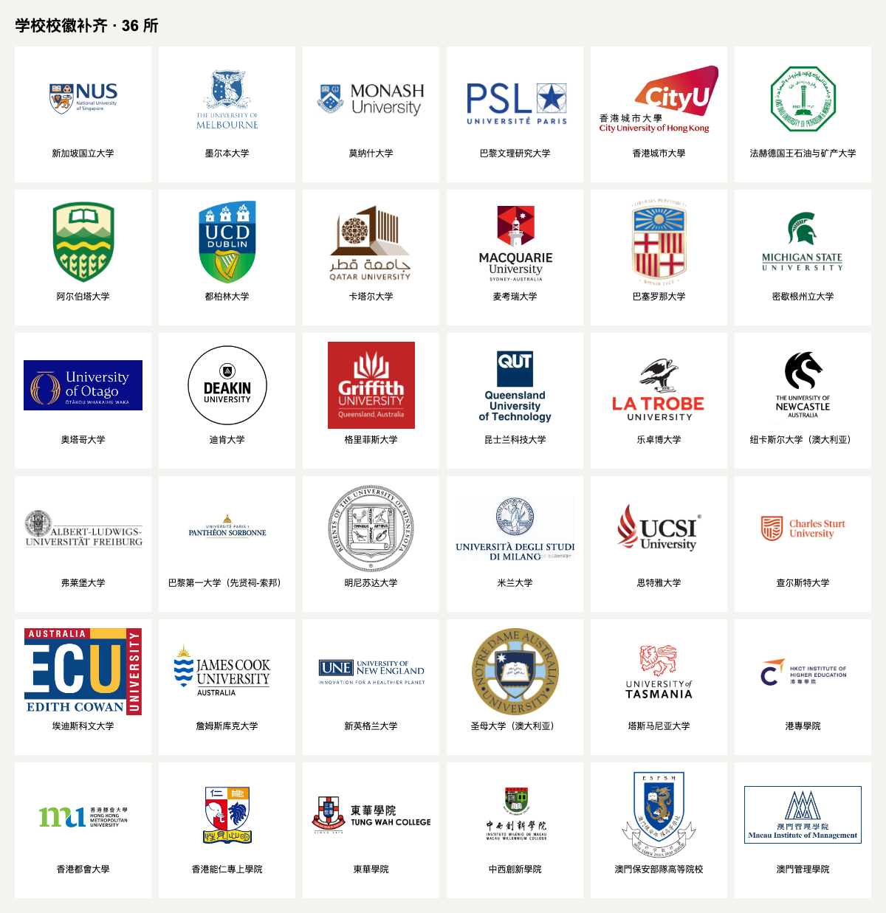

# 学校校徽补齐与审核记录

2026-11-18：按 Bing 图片搜索收集首轮候选，再逐图核对校名、图案、可读性及明显水印；不合适时补搜英文全名或缩写。已为 36 所学校补齐图片，当前学校库 287 所均有配置。

排除的典型结果：香港都会大学的猫／狼图片、塔斯马尼亚大学的建筑与其他 UTAS 院校、美国同名新英格兰大学、阿尔伯塔及其他学校的水印素材、港专院校与香港科技大学、学校基金会／院系／学生会标志。原始图片未做 AI 重绘。

| 学校 | 本次采用的 Bing 查询 | 结果序号 | 来源页面 | 原始图片 |
|---|---|---|---|---|
| 新加坡国立大学 | National University of Singapore (NUS) logo | 5 | [来源](https://seekvectors.com/post/nus-national-university-of-singapore-logo) | [图片](https://seekvectors.com/storage/images/NUS%20National%20University%20of%20Singapore-01.svg) |
| 墨尔本大学 | 墨尔本大学 校徽 | 2 | [来源](https://logo800.cn/shiliangtu-4505.html) | [图片](https://logo800.cn/uploads/shiliang/6/logo800_1649184692139533.jpg) |
| 莫纳什大学 | 莫纳什大学 校徽 | 3 | [来源](https://www.ausvisavictory.com/八大院校介绍/莫纳什大学/) | [图片](https://www.ausvisavictory.com/wp-content/uploads/2020/01/Asset-18@2x-100-3.jpg) |
| 巴黎文理研究大学 | 巴黎文理研究大学 校徽 | 2 | [来源](https://zhuanlan.zhihu.com/p/80319897) | [图片](https://picx.zhimg.com/v2-c72001dc9876756883d83fdfdcbfb7e0_720w.jpg?source=172ae18b) |
| 香港城市大學 | City University of Hong Kong logo 2024 orange | 1 | [来源](https://hksmic.org.hk/iset/2024/programme.html) | [图片](https://hksmic.org.hk/iset/2024/images/cityu_logo.png) |
| 法赫德国王石油与矿产大学 | 法赫德国王石油与矿产大学 校徽 | 2 | [来源](https://zhuanlan.zhihu.com/p/691565003) | [图片](https://picx.zhimg.com/v2-9c683ada612e4fc1df8882ea69d04e26_720w.jpg?source=172ae18b) |
| 阿尔伯塔大学 | 阿尔伯塔大学 校徽 | 3 | [来源](https://www.sohu.com/a/381364007_120424238) | [图片](https://5b0988e595225.cdn.sohucs.com/a_auto,c_cut,x_0,y_0,w_500,h_500/images/20191106/f4bc6de40af24dcaae8fd926035ecb89.jpeg) |
| 都柏林大学 | 都柏林大学 校徽 | 3 | [来源](https://www.zhihu.com/topic/20005962) | [图片](https://pic1.zhimg.com/50/v2-4f51866be05c016760bd8f9df5a3cb8a_720w.jpg?source=54b3c3a5) |
| 卡塔尔大学 | 卡塔尔大学 校徽 | 2 | [来源](https://www.phb123.com/bk/xuexiao/1987.html) | [图片](https://img.phb123.com/uploads/allimg/230530/66-2305301643250-L.jpg) |
| 麦考瑞大学 | 麦考瑞大学 校徽 | 2 | [来源](https://www.phb123.com/bk/xuexiao/1081.html) | [图片](https://img.phb123.com/uploads/allimg/230530/66-2305301500580-L.jpg) |
| 巴塞罗那大学 | 巴塞罗那大学 校徽 | 4 | [来源](http://lx.zywllx.com/colleges/details?id=2874) | [图片](http://lx.zywllx.com/Public/attached/image/20201209/5fd0a73f1e132.png) |
| 密歇根州立大学 | 密歇根州立大学 校徽 | 1 | [来源](https://www.phb123.com/bk/xuexiao/983.html) | [图片](https://img.phb123.com/uploads/allimg/220708/810-220FQ245350-L.png) |
| 奥塔哥大学 | 奥塔哥大学 校徽 | 2 | [来源](https://www.universityofotago.cn/1764449856012181504) | [图片](https://cdn.sin0sites.com/1152502623086411776/files_1764449856012181504/614285236_wechat%20new%20logo.png) |
| 迪肯大学 | 迪肯大学 校徽 | 5 | [来源](https://baike.baidu.com/item/迪肯大学/3456422) | [图片](https://bkimg.cdn.bcebos.com/smart/cefc1e178a82b901ab4de5457c8da9773812efe0-bkimg-process,v_1,rw_1,rh_1,pad_1,color_ffffff?x-bce-process=image/format,f_auto) |
| 格里菲斯大学 | 格里菲斯大学 校徽 | 3 | [来源](https://baike.baidu.com/item/格里菲斯大学/4475891) | [图片](https://bkimg.cdn.bcebos.com/smart/9a504fc2d5628535e5dd0db214a361c6a7efce1bc559-bkimg-process,v_1,rw_1,rh_1,pad_1,color_ffffff?x-bce-process=image/format,f_auto) |
| 昆士兰科技大学 | 昆士兰科技大学 校徽 | 3 | [来源](https://www.fuyangtop.com/?m=home&c=View&a=index&aid=125) | [图片](https://www.fuyangtop.com/uploads/allimg/20250227/1-25022G4264ab.jpg) |
| 乐卓博大学 | 乐卓博大学 校徽 | 1 | [来源](https://www.baike.com/wikiid/7343705388844947535) | [图片](https://p1-bk.byteimg.com/tos-cn-i-mlhdmxsy5m/2aa0856625d14291a4d38b80c386f089~tplv-mlhdmxsy5m-q75:0:0.image) |
| 纽卡斯尔大学（澳大利亚） | 纽卡斯尔大学（澳大利亚） 校徽 | 2 | [来源](http://insp.cufe.edu.cn/) | [图片](http://insp.cufe.edu.cn/uploads/200802/1-200P2164J2G9.png) |
| 弗莱堡大学 | 弗莱堡大学 校徽 | 5 | [来源](https://www.xuezaideguo.com/colleges/57.html) | [图片](https://oss.xuezaideguo.com/2024/03/19/JpLBFzxKIXeoYR5KOGYyXfH46ELrTPtdazoKpLBp) |
| 巴黎第一大学（先贤祠-索邦） | 巴黎第一大学（先贤祠-索邦） 校徽 | 1 | [来源](http://www.lxs01.com/ischool/817/) | [图片](http://www.lxs01.com/media/uploads/gud/ischool/badge/9e1140a6ddf445df95cc122d425e89e4.jpg) |
| 明尼苏达大学 | 明尼苏达大学 校徽 | 3 | [来源](https://baike.baidu.com/item/明尼苏达大学/2616594) | [图片](https://bkimg.cdn.bcebos.com/pic/0bd162d9f2d3572c69ef0b9a8713632762d0c363?x-bce-process=image/format,f_auto/resize,m_lfit,limit_1,h_336) |
| 米兰大学 | 米兰大学 校徽 | 3 | [来源](https://zhuanlan.zhihu.com/p/581635148) | [图片](https://pic3.zhimg.com/v2-4ac67a67c119f6649a596439f7e6ce3e_b.jpg) |
| 思特雅大学 | 思特雅大学 校徽 | 2 | [来源](https://baike.baidu.com/item/思特雅大学/2195190) | [图片](https://bkimg.cdn.bcebos.com/pic/c9fcc3cec3fdfc0392452677176a9094a4c27c1e88fc?x-bce-process=image/format,f_auto/resize,m_lfit,limit_1,h_440) |
| 查尔斯特大学 | 查尔斯特大学 校徽 | 2 | [来源](https://baike.baidu.com/item/查尔斯特大学/5892730) | [图片](https://bkimg.cdn.bcebos.com/pic/0e2442a7d933c895d143f440a94564f082025aafaac8?x-bce-process=image/resize,m_lfit,w_536,limit_1/quality,Q_70) |
| 埃迪斯科文大学 | "Edith Cowan" logo | 1 | [来源](https://opraprojects.com.au/projects/ecu-business-and-law-school/1200px-edith_cowan_university_logo_-_vector-svg/) | [图片](https://opraprojects.com.au/wp-content/uploads/2018/10/1200px-Edith_Cowan_University_Logo_-_vector.svg.png) |
| 詹姆斯库克大学 | 詹姆斯库克大学 校徽 | 2 | [来源](http://au.weilanliuxue.cn/lxzy/mxzx/13005.html) | [图片](http://au.weilanliuxue.cn/Scripts/ueditor1_4_3-utf8-net/net/upload/image/20180508/6366138662744896134035239.jpg) |
| 新英格兰大学 | 新英格兰大学 校徽 | 2 | [来源](https://baike.baidu.com/item/新英格兰大学/57699905) | [图片](https://bkimg.cdn.bcebos.com/pic/f2deb48f8c5494eef01fed8889bbf7fe9925bc31d059?x-bce-process=image/format,f_auto/resize,m_lfit,limit_1,h_336) |
| 圣母大学（澳大利亚） | 圣母大学（澳大利亚） 校徽 | 2 | [来源](https://www.applysquare.com/topic-cn/2H4r2AP1zZR/) | [图片](https://cdn.applysquare.net/a2/institute/au.cit/logo.png) |
| 塔斯马尼亚大学 | UTAS logo university | 5 | [来源](https://logowik.com/utas-university-of-tasmania-logo-vector-svg-pdf-ai-eps-cdr-free-download-12394.html) | [图片](https://logowik.com/content/uploads/images/utas-university-of-tasmania5171.jpg) |
| 港專學院 | 港專學院 校徽 | 3 | [来源](https://www.eduplus.hk/dse/local.jsp) | [图片](https://www.eduplus.hk/dse/images/picSchool/thumb_school_logo15.jpg) |
| 香港都會大學 | 香港都会大学 校徽 | 1 | [来源](https://baike.baidu.com/item/香港都会大学/55480651) | [图片](https://bkimg.cdn.bcebos.com/pic/6f061d950a7b02087bf4dadb5b96e5d3572c11df62f3?x-bce-process=image/format,f_auto/resize,m_lfit,limit_1,h_511) |
| 香港能仁專上學院 | "Nang Yan" college logo | 3 | [来源](https://www.goodschool.hk/u/香港能仁專上學院) | [图片](https://media.goodschool.hk/images/ulogo/ny.png) |
| 東華學院 | 東華學院 校徽 | 1 | [来源](https://www.goodschool.hk/u) | [图片](https://media.goodschool.hk/images/ulogo/twc.png) |
| 中西創新學院 | Macau Millennium College logo | 3 | [来源](https://vn.talkglobalstudy.com/vi/exhibitors/) | [图片](https://eis.bmi-systems.net/uploads/logos/gmQxxAmeic8jOHUE.png) |
| 澳門保安部隊高等院校 | 澳門保安部隊高等院校 校徽 | 2 | [来源](https://macaohe.org/macao-univ) | [图片](https://macaohe.org/wp-content/uploads/2025/06/澳門保安部隊高等學校.png) |
| 澳門管理學院 | 澳門管理學院 校徽 | 2 | [来源](https://www.esp.edu.mo/College-Counselor/Pages/College-Links.aspx) | [图片](https://www.esp.edu.mo/College-Counselor/PublishingImages/College-Links/MMA.png) |

完整文件名、尺寸和 SHA-256 见 `school-logo-sources-20261118.json`。搜索排名为该次查询中的位置，后续搜索结果可能变化。
